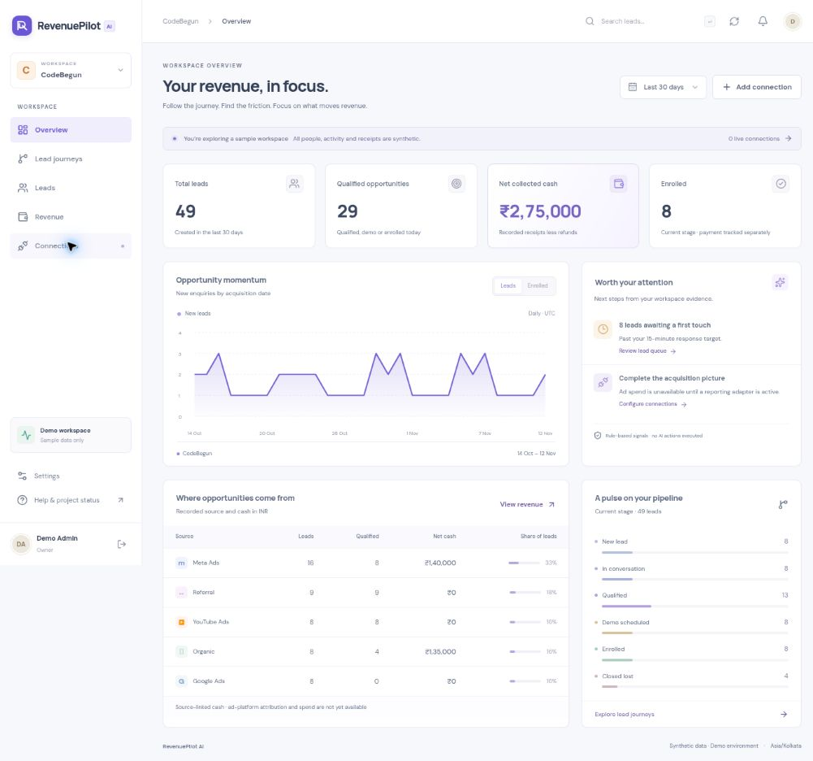

# RevenuePilot AI

An independent, multi-tenant revenue workspace. Built with React, TypeScript, Vite, Bootstrap 5, Express, MongoDB, Redis/BullMQ and Docker.

**Status: first working foundation (v0.1), for local evaluation.** This repository has no dependency on, connection to, or shared database with another application. Nothing has been deployed.



The screenshot contains fictional demonstration data, including an extra lead entered during UI verification. It is not CodeBegun business performance.

## What works

- Workspace registration, password sessions, optional authenticator MFA, tenant switching and role enforcement.
- Lead creation, search, pagination, stage changes with conflict protection, contact logs and asynchronous activity timelines.
- Manual receipt and refund ledger using integer minor units, durable idempotency and over-refund protection.
- Dashboard, current-stage journey view and source-linked cash reports. INR, USD and AED remain separate.
- Encrypted configuration drafts for eleven providers across advertising, CRM, calling, payments, AI and messaging.
- Website registration and an explicit-consent browser SDK with bounded retries and no field values or query strings.
- MongoDB transactional outbox, Redis/BullMQ worker, development Docker Compose and validation CI.

**Not live yet:** vendor OAuth/API adapters, gateway reconciliation, ad spend/ROAS, cross-device attribution, historical funnel conversion, AI-generated recommendations, outbound calls/messages, SaaS billing, invitations and account recovery. Provider capabilities shown in the catalog describe planned adapters. Saving a configuration does not activate it.

## Try the sample workspace

Install Node.js 24, then:

```sh
npm ci
npm run dev:demo
```

Open **http://localhost:3001** and choose **Explore sample workspace**. No provider credentials are needed. First startup downloads a MongoDB 7.0.48 binary for your platform. The demo starts a real, temporary MongoDB replica set and projects timeline events directly; it deliberately does not need Redis. Stopping it discards the demonstration database. Do not enter real credentials or personal data into demo mode.

The demo script works without shell-specific environment assignments, including on Windows. Local development accepts both `http://localhost:3001` and `http://127.0.0.1:3001`. Only these two hostname aliases, on the configured scheme and port, are accepted; production always requires the exact configured `WEB_ORIGIN`. A trailing slash in that environment value is normalized. Use one browser address consistently because each hostname keeps its own session cookie.

To change the frontend port, use `npm run dev:demo -- --port 3002`. If `.env` already defines `WEB_ORIGIN`, update its port to match; otherwise the demo derives it automatically. Vite also respects `API_PORT` when proxying API calls.

If an older running version shows **This request origin is not allowed**, stop it with Ctrl+C, run `git pull --ff-only origin main`, restart with `npm run dev:demo`, and reload the page. Both local hostnames now work on the configured port. Do not disable the origin or CSRF checks. A remaining error displays the configured address to open; check `WEB_ORIGIN` in `.env` if that address or port differs from the one you intend to use.

If an earlier checkout fails on Windows with MongoDB exit code `2`, update with `git pull --ff-only origin main` and retry. The initial script incorrectly passed the Unix-only `--nounixsocket` option to Windows; demo and test startup now use shared platform-aware options. The `node-abort-controller` npm warning comes from a BullMQ dependency and does not cause this startup failure.

## Persistent local development

Docker Engine with Compose is required for this path. These commands start only this project's resources:

```sh
npm ci
npm run setup:env
docker compose up -d mongo mongo-init redis
npm run dev
```

Visit **http://localhost:3001** and create a workspace. `setup:env` generates a private encryption key and does not overwrite an existing `.env`. Keep that key stable and backed up while its encrypted data exists. The API runs on port 4000, Vite on 3001, and the worker uses Redis. MongoDB must be a replica set for transactions.

Alternatively, run the entire local stack:

```sh
npm run setup:env
docker compose up --build -d
```

The web entry point is still `http://localhost:3001`. The `revenuepilot` Compose project uses its own network and volumes. Database/Redis ports bind to loopback; their local configuration has no authentication. **This Compose file is not a production deployment specification.** `docker compose down` stops the stack and preserves its named data volumes. Avoid `down -v` unless you intend to erase that local data.

If an old local `.env` has `REVENUEPILOT_DEMO=true`, set it back to `false` for persistent development. Do not run the demo and persistent stack on the same ports simultaneously.

## Validation

```sh
npm run typecheck
npm test
npm run build
npm audit --omit=dev
```

Tests exercise a real disposable MongoDB replica set, including cross-tenant requests, role masking, concurrent refunds and idempotency. See [verification and remaining gates](docs/ACCEPTANCE.md). CI contains validation only; no deployment workflow exists.

## Project map

| Path                  | Responsibility                                                   |
| --------------------- | ---------------------------------------------------------------- |
| `apps/web`            | React workspace and Bootstrap-based responsive UI                |
| `apps/api`            | Express authentication, tenant authorization and domain services |
| `apps/collector`      | Separate browser event ingestion process                         |
| `apps/worker`         | Outbox dispatch and timeline projection                          |
| `packages/core`       | Shared Zod contracts, permissions and money helpers              |
| `packages/connectors` | Provider manifests and adapter boundary                          |
| `packages/sdk`        | Consent-controlled browser telemetry                             |
| `scripts`             | Local runtime, synthetic seed, environment setup and build       |
| `tests`               | Domain, API and SDK acceptance coverage                          |

Read [architecture and schemas](docs/ARCHITECTURE.md), [API contract](docs/API.md), [connector and tracking guide](docs/CONNECTORS.md), [security](SECURITY.md), [UI specification](docs/UI.md) and [implementation roadmap](docs/ROADMAP.md).
