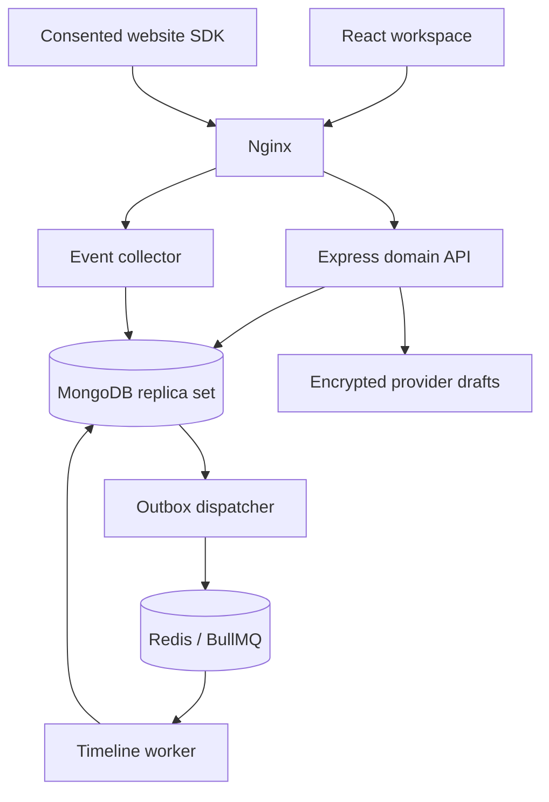

# Architecture and data model

## Boundary

RevenuePilot owns its identity, tenant memberships, data, credentials, processes and deployment lifecycle. CodeBegun is the first intended customer; the seed uses fictional CodeBegun records. There is no integration with any existing CodeBegun system in this release. Future integrations require a separately approved contract and adapter.

The initial design is a modular monolith with separate worker and collector processes. A single npm lockfile pins compatible dependencies. Shared TypeScript contracts avoid inconsistent client/server field definitions. Services can be split when measured workload or isolation requirements justify it.

The browser receives safe DTOs. API authorization checks the authenticated user's current membership for the tenant path on every request. A tenant header or body field never grants access. Counselor filters include both tenant and assignee. Parent objects are resolved inside that scope before dependent records are read or written.

## Consistency

A MongoDB transaction commits each lead/financial change together with its audit and outbox entry. The dispatcher can enqueue an event more than once. The worker uses the outbox ID as the event ID, upserts the projection and marks the outbox processed in the same transaction. Business deduplication persists independently of BullMQ retention.

Redis is a delivery aid, not the system of record. If unavailable, committed outbox entries remain in MongoDB. Failed jobs retry eight times with exponential backoff. Operational dead-letter tooling, queue health and automated alerting remain release gates. Demo mode replaces the Redis dispatcher with a periodic direct outbox drain; it exercises the same projection transaction.

## Collections

Canonical fields and indexes are executable in `apps/api/src/models.ts`. All business IDs are UUID strings; all dates are UTC BSON dates. All collections have creation/update timestamps. `tenantId` is immutable on tenant-owned documents.

| Collection            | Main fields                                                                                                            | Isolation / uniqueness                                        |
| --------------------- | ---------------------------------------------------------------------------------------------------------------------- | ------------------------------------------------------------- |
| `users`               | name, normalized email, password hash, encrypted MFA secret, last MFA time step                                        | Global identity; unique email                                 |
| `tenants`             | name, timezone, currency, response target, attribution preference, demo flag                                           | Tenant aggregate root                                         |
| `memberships`         | tenantId, userId, role, active status                                                                                  | Unique tenant/user pair; rechecked per request                |
| `auth_sessions`       | userId, token hash, CSRF token, expiry                                                                                 | Unique token hash; expiry TTL and runtime expiry check        |
| `leads`               | tenantId, name, encrypted email/phone, lookup hashes, course, source, campaign, stage, assignee, version, last contact | Tenant/stage/date and tenant/assignee indexes                 |
| `revenue_ledger`      | tenantId, leadId, capture/refund, minor units, currency, reference, original receipt, recorded source, note, evidence  | Unique tenant/reference; refund linked to same-tenant capture |
| `connections`         | tenantId, provider, label, accountId, credential cipher, configured key names, draft status                            | Tenant-owned; secret excluded from ordinary selects/DTOs      |
| `audit_logs`          | tenantId, actor, action, targetId, requestId                                                                           | Tenant/date index; no delete/update API                       |
| `events`              | tenantId, leadId, type, title, detail, actor, occurredAt                                                               | Outbox ID as unique event ID; tenant/lead/time index          |
| `outbox`              | tenantId, kind, payload, processedAt, attempts                                                                         | Pending/time index                                            |
| `idempotency_records` | tenantId, principal, route, key, request hash, response                                                                | Unique tenant/principal/route/key                             |
| `sites`               | tenantId, name, public key, exact origins                                                                              | Unique public key; server resolves owning tenant              |
| `web_events`          | tenantId, siteId, external eventId, pseudonymous IDs, type, path, consent, occurredAt                                  | Unique tenant/site/event ID                                   |
| `rate_buckets`        | hashed bucket key, count, expiry                                                                                       | Atomic increments and TTL                                     |

Email and phone lookups use tenant-specific HMAC values. Names, notes, activity details and manual references can still contain personal data; database storage encryption and restricted operator access are required before customer use. Audit logs are append-only through the application, not cryptographically immutable against a database administrator.

## Money and measurement

- Amounts travel as **integer strings in minor units**, with BigInt arithmetic. Floating-point amounts and zero/negative captures are rejected. INR/USD/AED currently use two minor digits.
- A refund belongs to one capture, tenant, lead and currency. The original capture tracks refunded minor units inside a transaction; concurrent refunds cannot exceed it. Original amounts are not edited; the ledger adds refund entries. A unique reference and durable request key prevent replay duplicates.
- A manual record is not gateway verification, settlement, accounting revenue or evidence of enrollment. Stage changes never create cash; cash never creates enrollment.
- Overview lead metrics use leads acquired in the selected rolling 7/30/90-day window. Stage counts describe their **current** position. Trend buckets use UTC acquisition date; an enrolled trend means currently enrolled leads grouped by acquisition date.
- Cash metrics use receipt/refund recording time in that window, independently of lead acquisition time. Source-linked cash uses the source copied onto each receipt; refunds inherit their capture's source. These two cohorts need not have the same population.
- Workspace currency selects the displayed summary only. The API returns separate currency totals; there is no implicit FX conversion.
- A source is currently a manually recorded channel. No causal, view-through, multi-touch or cross-device attribution is claimed. The stored attribution preference and allocation helper are preparation for a future engine, not active report behavior.
- Response coverage counts new-stage leads without recorded contact, beyond elapsed response minutes; it does not use working hours. A stage change alone is not contact evidence.
- Browser events are untrusted observations. A submitted form event is an attempt, not an accepted lead. People who click an ad but never load the website cannot be individually observed here.

## Scaling and operations

This foundation computes bounded-window overview reports in application memory and uses offset pagination. Before scale: add indexed rollups, cursor pagination, cohort definitions with tenant-local reporting boundaries, payload/retention budgets and per-tenant queue fairness. Load-test real tenant distributions before claiming capacity.

A production topology needs TLS, authenticated managed/secured MongoDB replica sets, authenticated Redis, private networking, secret management and backup/restore exercises. Preserve the data key securely; rotation needs versioned ciphertext and migration tooling. Image versions are pinned for reproducibility but not yet digest-pinned or container-scanned in this environment. No production infrastructure has been created.
