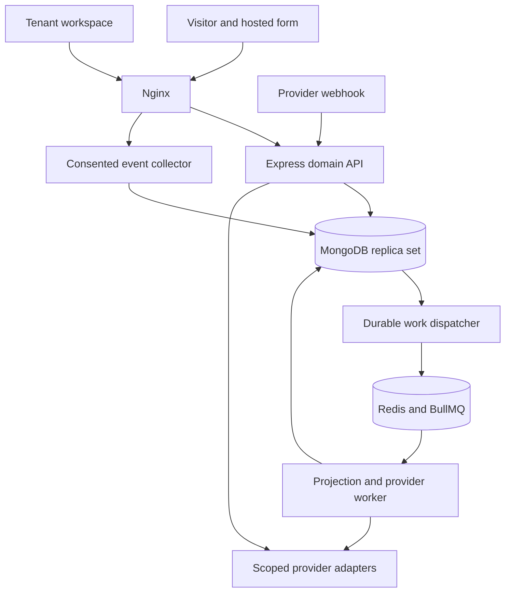
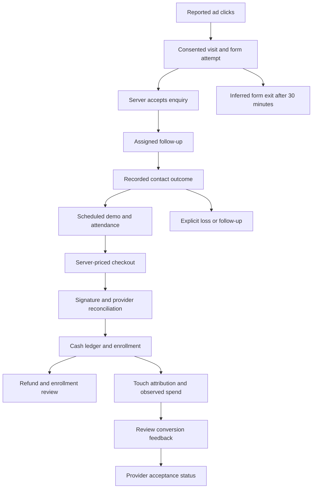

# Technical architecture

## Independent product boundary

RevenuePilot owns identity, tenant membership, contacts, evidence, financial ledger, provider credentials and operational state. CodeBegun is the first intended tenant, not a special code path. The two seeded tenants are synthetic. No LMS source, endpoint, database, credentials, deployment or configuration is accessed. Any future CodeBegun integration must use an explicitly approved external contract; no shared collection or tenant header is trusted.

A modular monolith keeps transactional rules together while separating Express API, collector and asynchronous worker processes. One lockfile pins the React/Vite/Bootstrap application and shared TypeScript packages. MongoDB must support transactions. Redis/BullMQ is delivery infrastructure, never the authoritative record.

The API performs explicit readonly provider checks/imports and checkout creation. Worker dispatch handles approved calling, messaging, AI/conversion commands and incoming webhook projections. The browser never receives provider secrets. Provider selection is in the connector registry, not lead, enrollment or ledger models.

## Journey and evidence

No individual-level ad click is invented. Platform clicks/impressions are aggregate imports. Only consented browser activity is observable. A browser submit event is an attempt; an accepted enquiry exists only after the authoritative transaction commits. Consent blockers and anonymous visitors create explicit measurement gaps.

A form supplies tenant, course, immutable offer price, exact allowed origins and eligible assignees. The server resolves these from a public key, rejects client tenant/amount fields and issues an opaque 24-hour acceptance token. Contact/course identity HMAC deduplicates returning enquiries without exposing existing customer IDs or overwriting their details. Concurrent replays use a unique form/attempt key and normalized request hash. Round-robin assignment increments transactionally among currently active eligible members.

The contact workflow records outcomes independently of lead stages. A scheduled demo is not attendance; host bookings are serialized at the tenant root and checked for overlap. Attendance cannot precede start time. No-show/follow-up outcomes create tasks. Marking a lead enrolled manually does not create payment-backed enrollment evidence.

An offer is a full-enrollment price. Demo fees, deposits, installment schedules and tax invoices are not modeled as enrollment offers. One order per lead/form prevents different confirmation links from charging the same offer again. Re-enrollment after refund requires an explicitly new offer; ordinary retries reuse the existing order.

## Transactions, retries and external boundaries

| Operation                   | Transaction boundary                                                               | Replay behavior                                                                       |
| --------------------------- | ---------------------------------------------------------------------------------- | ------------------------------------------------------------------------------------- |
| Accepted enquiry            | Lead, identity, consent, task, touch, acceptance, audit/outbox, quota              | Same attempt/body returns the same opaque token; changed body conflicts               |
| Manual lead/contact/receipt | Business record, audit, outbox, durable idempotency response                       | Key binds tenant, principal, route and normalized body                                |
| Timeline projection         | Event upsert plus outbox processed marker                                          | Outbox ID is event ID; repeated projection is harmless                                |
| Payment settlement          | Receipt/refund, cumulative capture balance, order, enrollment, milestones, outbox  | One capture/order; only increasing cumulative refund deltas are applied               |
| Incoming webhook            | Verified raw payload encrypted into unique connection/event inbox                  | Same bytes accepted; conflicting reuse rejected; processing retried up to eight times |
| Outbound command            | Approval persisted, then atomic worker claim before external I/O                   | No automatic resend after ambiguous result; expired running lease becomes unknown     |
| Billing entitlement         | Current provider subscription/invoice, server price mapping, tenant plan and audit | Browser redirect cannot grant plan; late superseded subscription events ignored       |

Network I/O stays outside MongoDB transactions. The state before checkout creation becomes `unknown` before issuing the request; a timeout requires reconciliation, not another charge. Stripe receives a stable idempotency key; Razorpay receives a stable reference. A provider read must match order reference, amount, currency, captured status and environment before recording money. Redirect query parameters and browser success messages are never evidence.

Webhook processing can repeat; business uniqueness is retained independently of Redis job retention. Incoming work recovers an expired lease for idempotent replay. Outgoing work and account mail recover an ambiguous lease as unknown and require investigation. A paused connection blocks new execution and moves queued commands back to review; an already-started remote request cannot be recalled.

## Tenancy and authorization

Global user identity may have multiple memberships. The selected tenant path is only an address: the API checks active membership on every request. Counselor reads/writes further include `assignedTo`. Object IDs and foreign references are resolved in that scope before use. Workers derive tenant from stored command/webhook records and resolve the connection with the same tenant. Signed webhook credentials identify the owning connection; incoming tenant fields cannot redirect it.

Roles and permissions are executable in `packages/core/src/contracts.ts`. Owner/admin operate settings and connectors; counselors manage their assigned sales work; analysts see non-PII analytics; finance handles receipts; viewers have restricted reads. Owner is required for SaaS billing and administrator/owner membership changes. Seat checks and last-owner changes serialize at the tenant root. See SECURITY.md for details.

## Money and reports

Amounts are positive integer strings in minor units; calculations use BigInt. INR/USD/AED remain separate. Refund allocation uses the difference between cumulative attributed refund totals, preserving every minor unit even across repeated small refunds.

Evidence categories are `manual_record`, `sandbox`, `provider_test` and `provider_verified`. Non-demo overview cash excludes sandbox/provider-test records. Journey reports expose each evidence category separately. Only verified live receipts are compared with verified live imported spend. Bank settlement, tax/accounting revenue and profitability are separate concepts.

The journey cohort contains leads created in the selected rolling 1–90-day window. Milestones are unique lead coverage as of report time, may be skipped and need not be monotonic. Stalls concern open leads older than seven days. Form exits concern observed attempts at least 30 minutes old. Recorded loss notes are distinct from inferred stalls. Cash/refunds use their own recording-time cohort.

Touch models use eligible consented touches in the 30 days before each capture: earliest, latest or equal weight per touch. Source tags are self-reported, not ad-platform attribution. Campaign/ad joins require exact source, account ID, campaign ID and ad ID. Names never create a join. Duplicate imports of the same account/ad/date/currency/evidence are deduplicated in reporting. ROAS uses observed UTC daily spend and surfaces coverage; partial-day/window differences and attribution assumptions remain explicit. No causal, view-through, cross-device or FX claims.

## Capacity and evolution

Reports currently cap at 10,000 cohort leads, 10,000 receipts, 20,000 attempts/spend rows and 100,000 touch records; excessive requests return 422 with a shorter-window instruction. Grouped in-memory calculations are appropriate for pilot evaluation, not a measured scale promise. Lists use bounded offset pagination; imports use vendor cursors. Background conversion planning streams recent evidence and respects monthly quotas, but a commercial high-volume deployment needs materialized rollups, per-tenant queue fairness and provider/account-specific backfill scheduling.

Future service splits should follow observed load: collector ingestion, provider execution and report projections are natural boundaries. Enterprise isolation can use a dedicated database/key/queue per tenant through repositories behind the same domain contracts. No enterprise isolation, SSO or regional compliance certification is claimed in this release.
