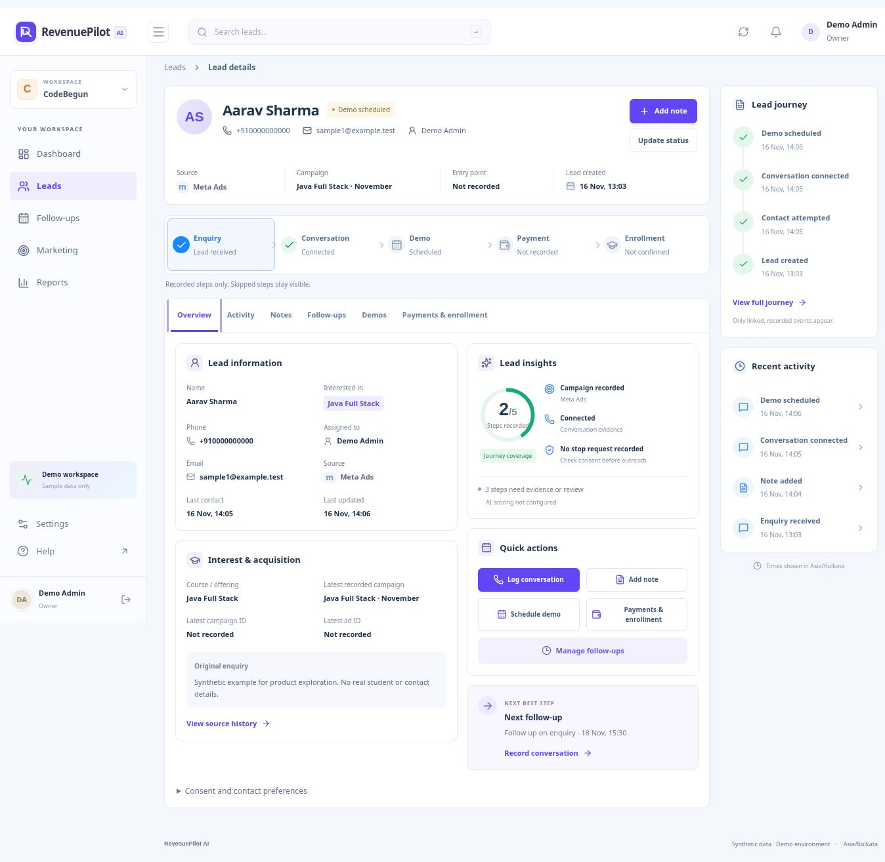

# Lead details workspace

The lead details route (`/leads/:leadId`) uses the supplied reference design: a full-width search header, compact navigation, profile and source summary, a horizontal journey, overview cards, and a journey/activity sidebar. Open **Leads → any lead** to use it.

## What appears where

| Area                  | Purpose and data                                                                                                                                                                                |
| --------------------- | ----------------------------------------------------------------------------------------------------------------------------------------------------------------------------------------------- |
| Profile               | Name, role-visible contact details, assigned counselor, current status, source, campaign, entry point and creation time. Add note and Update status retain write permissions.                   |
| Journey strip         | Enquiry, conversation, demo, payment and enrollment. Each step uses existing recorded evidence independently. Scheduling is not attendance; a manually selected status is not payment evidence. |
| Overview              | Contact and offering details, campaign/ad identifiers when recorded, original enquiry, journey coverage, quick actions and the existing next-step rules.                                        |
| Activity              | Latest 100 projected timeline events, recorded milestones and up to 100 source touchpoints. Source history remains available even when no campaign identifiers were recorded.                   |
| Notes                 | Original enquiry plus team notes among the latest 100 activities. Conversation and status-change notes remain in Activity.                                                                      |
| Follow-ups            | Existing conversation outcome form, next follow-up, task history and imported calls.                                                                                                            |
| Demos                 | Existing host/time scheduling and attendance/outcome recording.                                                                                                                                 |
| Payments & enrollment | Existing ledger link, optional provider checkout/reconciliation, and separate staff enrollment confirmation. Roles without finance access see Enrollment only.                                  |
| Right sidebar         | Latest five recorded milestones/source touchpoints and latest four activities. Times use the workspace timezone.                                                                                |

The progress ring measures recorded journey steps. It is **not a lead-quality score, conversion probability or AI prediction**. AI scoring remains unconfigured under backlog #15. The design does not create person-level ad impressions, campaign clicks, email opens, location, budget, preferred mode or other unavailable evidence. Unrecorded campaign/entry identifiers are labelled accordingly. Quick actions open supported workflows; they do not launch calls, send email/WhatsApp, or activate advertising.

## Team note API

`POST /api/v1/tenants/:tenantId/leads/:leadId/notes`

- Body: `leadNoteInput`, exactly `{note: string}`; trimmed length 3–1000. Unknown fields are rejected.
- Requires current session, allowed origin, CSRF, `leads.write`, assigned-lead scope and `Idempotency-Key`.
- Foreign, unassigned or erased leads return 404; insufficient role returns 403; invalid input returns 422; reused key with a changed body returns 409.
- Writes `lead.note_added.v1` to the durable timeline outbox and `lead.note_added` to audit in one transaction. Success is 201 `{saved:true}`. Retrying the same operation does not duplicate a note.
- Preserves lead stage, original enquiry note, last-contact time, follow-up tasks and milestones. Increments the concurrency version and update timestamp to serialize safely with erasure and status writes. Note saving does not count as contact or qualification.
- Existing worker projection makes the note visible in `GET /leads/:leadId`. The page refreshes immediately and again after 1.5 seconds; a saved-note notice explains a pending projection. Refresh data can retry the read if the worker is delayed.
- Existing event-detail PII masking, privacy export/erasure and retention handling apply. A viewer can see that a note exists but cannot read its content. Audit and idempotency results do not include note text.

## Layout and accessibility

- Desktop: main workspace and right rail, with two overview columns.
- Tablet: journey/activity rail moves below the primary workspace; overview becomes one column on narrow widths.
- Mobile: stacked cards, horizontally scrollable stages and tabs, and a navigation drawer. The entire document should not scroll horizontally.
- Tabs have selected state, associated tabpanels and Arrow/Home/End keyboard navigation. Existing native dialogs keep validation and keyboard dismissal. Icons accompany text labels; journey state is not conveyed only by color.
- Existing navigation destinations and permissions remain in place. Shell styling is scoped to the lead-details route.

## Release checks

- Automated: 112 tests pass, including new note persistence/idempotency, tenant/counselor isolation, viewer masking, input validation, erased-lead rejection and unchanged contact/status evidence. Existing skipped-stage, finance access, manual receipt/enrollment and refund tests pass.
- Production build and TypeScript checks pass. Existing Vite bundle-size advisory remains non-blocking.
- Browser: verified sample note creation, unchanged contact state after adding a note, connected conversation with follow-up, demo scheduling, payment view and enrollment dialog. Verified desktop layout and 390px iframe viewport with no horizontal document overflow, plus mobile navigation.
- Synthetic data only. No production lead, advertising, payment or outreach was changed during verification.
- Deploy **both API and web** from the same release; the redesigned Add note control requires the new endpoint. No new environment variables, collections or migration are required. Keep the existing worker running for timeline projection.

Deployment to the user's Hostinger VPS is a separate, unverified step. Opening the running site does not prove it has this release; check the deployed commit and rebuild the API/web images before live acceptance testing.
